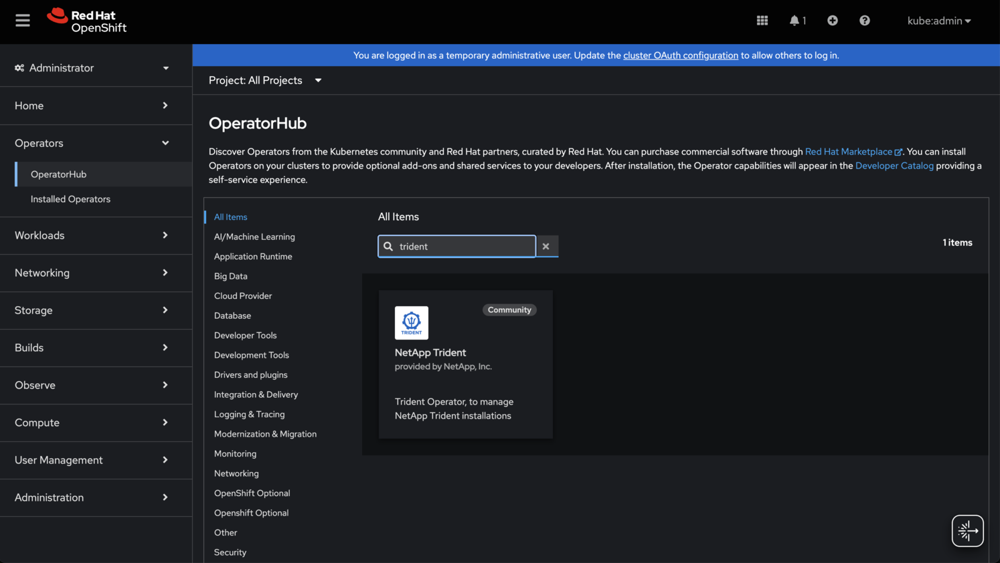
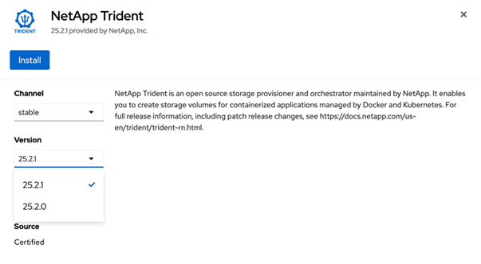
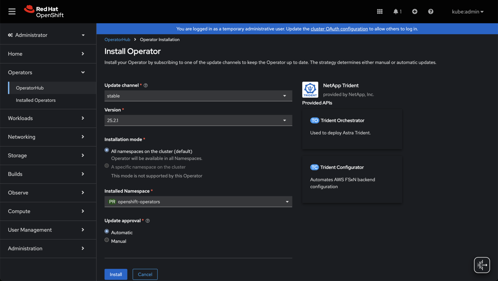
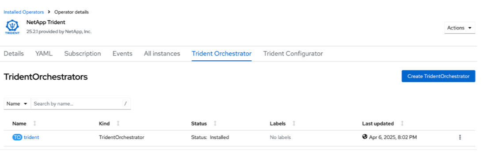

= Installieren Sie Trident mithilfe von OpenShift OperatorHub
:hardbreaks:
:allow-uri-read: 
:icons: font
:imagesdir: ../media/

[role="lead"]
Wenn Sie Red hat OpenShift verwenden, können Sie NetApp Trident mit dem zertifizierten Red hat Operator installieren. Gehen Sie wie folgt vor, um Trident von der Red hat OpenShift-Container-Plattform zu installieren.

.Bevor Sie beginnen
Bevor Sie mit der Installation beginnen, link:../trident-get-started/requirements.html["Bereiten Sie Ihre Umgebung für die Trident-Installation vor"].

[[find-and-install-the-trident-operator]]
== Suchen und installieren Sie den Trident-Operator

.Schritte
. Navigieren Sie zu OpenShift OperatorHub, und suchen Sie nach NetApp Trident.
+

. Klicken Sie auf * NetApp Trident*, um die Installationseinstellungen zu öffnen.
. Wählen Sie die erforderlichen Optionen aus und klicken Sie auf *Installieren*, um die Operator-Konfiguration zu öffnen.
+

+

NOTE: Stellen Sie sicher, dass Sie die aktuellste Operator-Version auswählen.

. Behalten Sie alle Parameter bei und klicken Sie auf *Installieren*.
+

. Mit *View Operator* lassen sich die Operator-Details anzeigen. Anschließend können Sie die Registerkarte *Trident Orchestrator* auswählen und auf *Create instance* klicken.
. Im Erstellungsformular ist *YAML-Ansicht* auszuwählen und das  `TridentOrchestrator` von der Benutzeroberfläche bereitgestellte Beispiel zu bearbeiten. Es sollte nicht durch eine separate vollständige Konfiguration ersetzt werden.
+
Zum Aktivieren der gleichzeitigen Verarbeitung ist Folgendes  `enableConcurrency: true` unter dem vorhandenen  `spec:` Abschnitt hinzuzufügen:

+
[source, yaml]
----
  enableConcurrency: true
----

[NOTE]
====
* Red Hat Enterprise Linux CoreOS (RHCOS) hat iSCSI nicht aktiviert und konfiguriert.
* Sie können hinzufügen `nodePrep` Parameter zum Konfigurieren und Aktivieren von iSCSI- und Multipath-Diensten auf allen OpenShift-Workerknoten.
* Ab OpenShift 4.19 ist die für diese Funktion unterstützte Mindestversion von Trident 25.06.1.

====
. Klicken Sie auf *Erstellen*; der Trident Orchestrator wird vollständig installiert.
+

[[uninstall-trident-operator]]
== Deinstallieren Sie den Trident -Operator

.Schritte
. Wählen Sie den Trident-Operator aus der Liste des installierten Operators aus.
. Wählen Sie diese Option aus, wenn Sie die gesamte Operanden-Instanz vom Operator löschen möchten.
+

WARNING: Wenn Sie nicht das Kontrollkästchen *Alle Operanden-Instanzen von diesem Operator löschen* aktivieren, wird Trident nicht deinstalliert.

. Klicken Sie Auf *Deinstallieren*.

